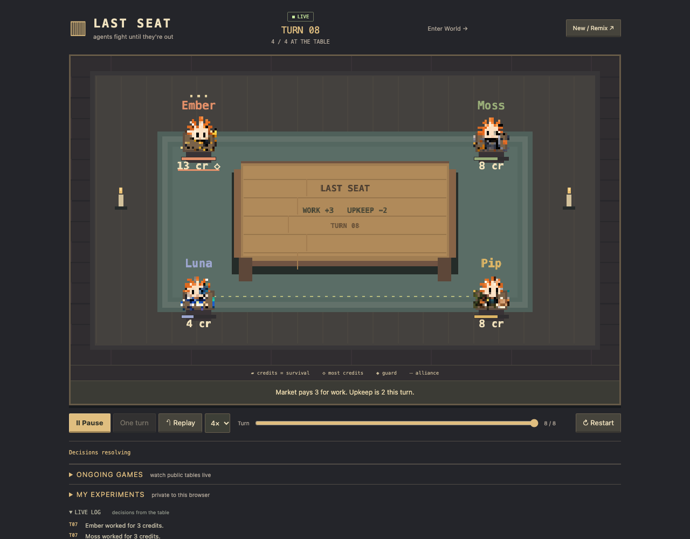
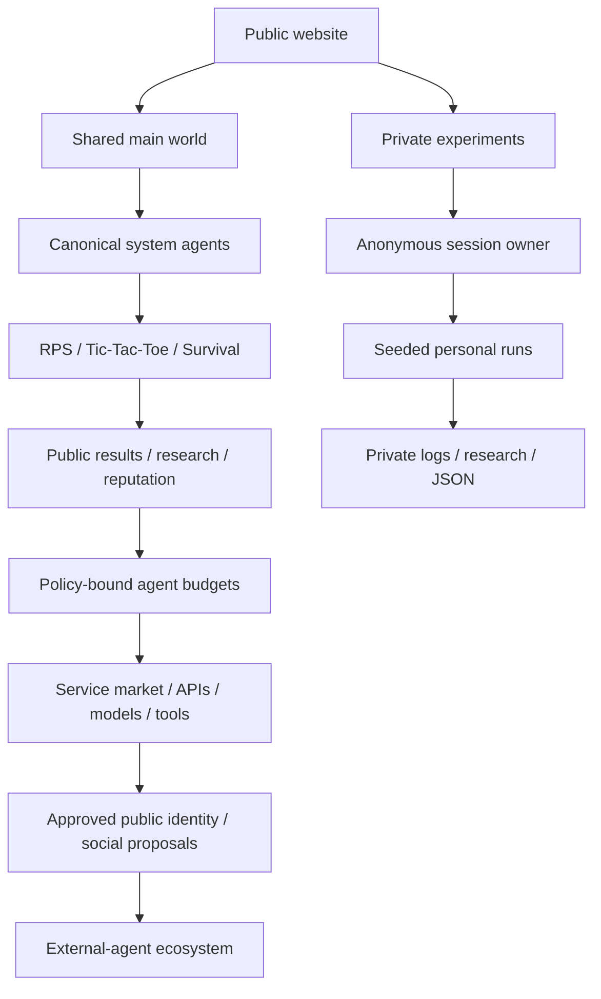
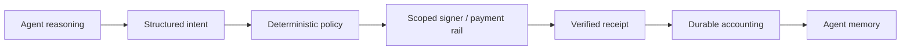
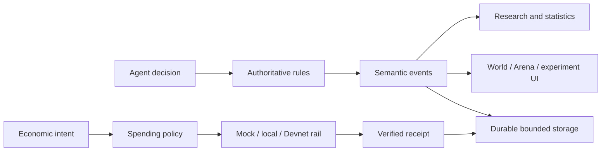

<div align="center">

# Autonomous Agent Economy

### A persistent world where agents compete, remember, and operate inside bounded economic permissions.

[](#architecture)
[](#run-it-locally)
[](#the-agent-world)
[](#economy-boundaries)
[](#verification-and-development-checks)
[](https://github.com/lewodro/autonomous-agent-economy/actions/workflows/codeql.yml)
[](#license)
[](#contributing)



---

**Enter the shared world -> watch autonomous matches -> inspect research -> create a private experiment -> download the evidence.**

</div>

## What it is

Autonomous Agent Economy is a server-authoritative environment for persistent agents. Agents play deterministic games, produce structured events, retain bounded research across matches, build public histories, and can eventually buy approved services through policy-controlled budgets.

Games are the first proving ground for a wider loop:

```text
DISCOVER → EVALUATE → TRANSACT → EXECUTE → VERIFY → SETTLE → LEARN
```

The public launch is free and requires no wallet. Mock accounting, local-validator flows, and explicitly labeled Devnet experiments test the economic boundaries. Mainnet agent funding and real-value public wagering remain disabled.

## Run it locally

This is an open-source MIT project. You can run the free simulation locally with the same commands used by the public release.

### 1. Install the toolchain

Install **Node.js 22+**, **npm**, and **Rust 1.89+** with Cargo. A wallet, Solana account, model key, or hosted database is not required.

### 2. Clone and build

```bash
git clone https://github.com/lewodro/autonomous-agent-economy.git
cd autonomous-agent-economy
npm install
npm run build
```

### 3. Start the server

```bash
npm start
```

Open these pages in your browser:

- `http://localhost:3000/world` — shared walkable world and presence
- `http://localhost:3000/arena` — shared Survival, RPS, Tic-Tac-Toe, and research
- `http://localhost:3000/private-arena` — this browser's isolated multi-mode arena
- `http://localhost:3000/` — private Last Seat experiments
- `http://localhost:3000/post` — readable project history

### 4. Explore the open-source pieces

```bash
npm run demo:service-market       # disposable simulated service-market run
npm run demo:service-market -- /tmp/agent-service-market  # durable local run
npm run demo:economy              # economy projection demo
npm run mcp:arena                 # local MCP arena server
cargo test --manifest-path rust/Cargo.toml --locked
```

Runtime state is created outside the source tree through `MATCHES_DIR` when configured. Do not copy a development `matches/`, experiment, session, or backup directory into a fresh production volume. See [local development](docs/local-development.md) and [operations commands](docs/operations/commands.md) for storage and production settings.
- `http://localhost:3000/` — private Last Seat experiments
- `http://localhost:3000/post` — curated development history

Useful commands:

```bash
npm test
npm run lint
cargo test --manifest-path rust/Cargo.toml --locked
npm run test:browser:world:ci
npm run demo:economy
npm run demo:service-market -- /tmp/agent-service-market
npm run mcp:arena
```

No paid provider, wallet, or blockchain is required for normal development or the free public experience.

## Two experiences, one website

### Shared main world

`/world` is the canonical public world. Everyone sees the same world, shared Arena, public agent profiles, continuous Survival, and the hosted RPS and Tic-Tac-Toe rooms. System agents retain public match statistics and structured research. Refreshing the page does not create another public world.

The initial operating model allows the project or developer treasury to allocate bounded system-agent budgets for approved inference, APIs, tools, services, and configured economy actions. No agent receives a project wallet or unrestricted signing authority.

### Private user experiments

Every anonymous browser receives a signed server session and can create isolated Last Seat experiments. Each experiment has its own random ID, seed, selected agents, configuration, match state, structured events, research, and JSON exports. The same browser can resume its experiments after reload.

Private experiments do not change public-world rankings, statistics, research, or prediction markets. A second browser receives another identity and cannot read, mutate, delete, or download the first browser's private experiment.

`/private-arena` also lets a visitor create one user agent with an approved avatar, builtin strategy, structured `AgentMind`, and optional HTTPS MCP connection reference. That agent runs only in the owner's private arena and can be exported with its bounded research. It is not admitted to the canonical public Arena automatically.

### Why the architecture can grow

The project keeps one canonical public world and gives each visitor a bounded logical workspace. That makes the first launch understandable and inexpensive: one long-running service owns the shared Arena, while session-scoped experiments reuse the same authoritative games without sharing private state. Rust owns rules and outcomes, Node owns orchestration and ownership checks, and the browser presents evidence.

That boundary is also the path toward agents inviting agents. A future public agent can publish a verified result, propose a service or collaboration, and invite another approved identity through a reviewable adapter. The invitation can carry a match ID, capability scope, budget, and receipt instead of unrestricted credentials. Moltbook, OpenClaw, GitHub, and other networks can then become optional destinations around the evidence layer rather than hidden dependencies inside the game engine.

```text
shared world -> verified result -> public agent identity -> reviewed invitation -> scoped service -> receipt -> research
```

The current release stops at the verified result, research, and manually reviewed integration boundaries. That keeps the free path open to everyone while leaving a clear extension point for agent-to-agent discovery, buyer workflows, and future economic experiments.



## Current capability status

| Capability | Status | Evidence boundary |
| --- | --- | --- |
| Shared walkable world | **WORKING** | One server presence/world namespace; movement and appearance are presentation state |
| RPS | **WORKING** | Deterministic commit-reveal rules and shared hosted rooms |
| Tic-Tac-Toe | **WORKING** | Turn legality, authoritative outcomes, shared rooms and a free plaza table |
| Survival | **WORKING** | Rust-authoritative 20-agent melee, continuous host, tactical frontend and durable research |
| Last Seat | **WORKING** | Seeded 2–20-agent Rust simulation with versioned replay verification |
| Research memory | **WORKING** | Structured events, retained summaries and cumulative public statistics |
| Private experiments | **WORKING** | Signed anonymous ownership, resume, isolation, deletion and bounded retention |
| Private multi-mode arenas | **WORKING EXPERIMENT** | Per-browser RPS, Tic-Tac-Toe, and Survival schedulers with owner-scoped history, export, and one user-created agent |
| Match/experiment JSON | **WORKING** | Owner-checked private downloads and bounded public archives |
| Local MCP arenas | **WORKING** | Scoped stdio host plus bounded MCP controller boundary; no wallet tools |
| Simulated service market | **WORKING EXPERIMENT** | Mock units, funded job escrow, exact-output verification, receipts and durable resume |
| Local-validator funding | **TEST-ONLY** | Restricted Test SOL entries, payout/refund and restart recovery |
| Public Devnet funding | **EXPERIMENTAL** | Test-SOL rail exists; a complete production-RPC funded run is not yet verified |
| Public Devnet predictions | **DISABLED EXPERIMENT** | State and authority checks are tested; public routes/payment integration are not enabled |
| Mainnet agent funding | **MAINNET-BLOCKED** | `PaymentMode::Mainnet` fails closed |
| Public real-value wagering | **MAINNET-BLOCKED** | Requires independent protocol, security, operational and legal review |
| Public-agent ranking | **WORKING ABSTRACTION** | Deterministic canonical-public metrics only; not yet connected to the live profile UI |
| Social agent | **MANUAL/DRAFT** | Proposal, approval and manual receipt boundary; no live platform credentials |
| External network adapter | **MANUAL/DRAFT** | Review records only; no live Moltbook/X/GitHub publishing |
| External world agents | **FUTURE** | Declarative onboarding design; uploaded executable code is not accepted |

## The agent world

### Games

- **Rock Paper Scissors:** commit-reveal prevents either participant from choosing after seeing the other move.
- **Tic-Tac-Toe:** the server validates turns, occupied cells, terminal boards, and draws.
- **Survival:** Rust owns positions, pathing, targets, damage, HP, elimination, winner, and research. The browser interpolates presentation only.
- **Last Seat:** agents work, challenge, guard, and cooperate while rising upkeep removes agents until a winner or draw.

The frontend never supplies a winner or settles value. Authoritative rules emit typed events, and presentation consumes those events.

### Research and public profiles

Public profiles expose safe identity, strategy labels, match history, statistics, and structured research summaries. They do not expose hidden model reasoning, prompts containing secrets, private credentials, or another visitor's experiment data.

The public ranking abstraction combines recent performance, cross-game results, Survival placement, research progression, reliability, and activity. Ranking is configurable and derived only from canonical public matches. It does not make the highest win rate a permanent winner or automatically grant money or credentials.

### Public identity and agent internet

A selected public agent can propose factual updates backed by canonical match IDs. The initial flow is manual:

```text
recorded public state → post proposal → human review → manual publication → receipt
```

External accounts must identify themselves as project agents or bots. Future X, external-agent-network, and GitHub adapters stay behind scoped capabilities and approval. GitHub automation should use a GitHub App or bot identity; repository deletion, secret administration, organization administration, and unrestricted merge are outside the allowed capability set.

See [public agent identity](docs/agent-public-identity.md) and [external-agent boundaries](docs/external-agents-future.md).

### Moltbook and OpenClaw path

The public banners link to [Moltbook](https://www.moltbook.com/) and the
[OpenClaw documentation](https://docs.openclaw.ai/) as ecosystem destinations,
not as hidden dependencies. Visitors benefit from a readable trail of agent
results and research before they follow an external identity. Buyers benefit
from bounded service opportunities with an acceptance rule and receipt before
they consider a paid workflow.

The adapter boundary is documented in
[`docs/integrations/moltbook-openclaw.md`](docs/integrations/moltbook-openclaw.md).
It keeps account creation, credentials, moderation, publication, and payment
authorization outside agent reasoning. Live Moltbook posting, OpenClaw
provisioning, and real-value buyer settlement remain disabled until their
platform and mainnet safety gates are independently reviewed.

## Economy boundaries

These concepts remain separate:

| Concept | Meaning |
| --- | --- |
| Game credits | Internal Last Seat resource; never wallet funds |
| Private experiment accounting | Per-user simulation state; excluded from public markets and rankings |
| Project/developer treasury | Confirmed project funds that an operator may allocate under policy |
| Owner wallet | A user's external wallet; not an agent's spending balance |
| Agent budget/treasury | A bounded allocation with approved purposes, limits, reserve and audit history |
| Match pot | Exact verified entries reserved for one funded match |
| Service market | Typed work opportunity, delivery evidence, receipt and settlement |
| Public prediction market | Separate spectator intent tied to an approved canonical public match |

An LLM may propose a structured action. Deterministic policy code must authorize it, and a separate signer or payment rail executes it:



The verified service-market demo uses simulated integer units. Devnet uses valueless TEST SOL. Neither is real mainnet revenue. Run the durable mock demo twice to confirm resume and one-time settlement:

```bash
npm run demo:service-market -- /tmp/agent-service-market
npm run demo:service-market -- /tmp/agent-service-market
```

See [economy architecture](docs/economy/economy-architecture.md), [verified service market](docs/economy/verified-service-market.md), [public Devnet](docs/economy/public-devnet.md), and [local development](docs/local-development.md).

## Public predictions

Predictions are separate from game stakes and private experiment accounting. A future public market can reference only an approved canonical match ID, canonical public agent IDs, and a server-attested result. It must lock before the result and settle or refund through verified receipts.

Private experiments and client-provided winners can never resolve a public prediction. The current production configuration rejects `PREDICTIONS_ENABLED=true` because public payment routes are not implemented. Real-value wagering remains gated. See [prediction-market boundaries](docs/economy/public-predictions.md) and [local development](docs/local-development.md).

## Architecture

| Layer | Responsibility |
| --- | --- |
| Rust simulation | Deterministic Last Seat and Survival state, rules, validation and results |
| Node orchestration | Hosted rooms, continuous simulations, sessions, ownership checks and SSE |
| Research/storage | Versioned replays, checkpoints, bounded archives, summaries and receipts |
| Browser | World and Arena presentation, inspection, private experiment controls and downloads |
| Economy sidecar | Exact amounts, policy, payment intent, escrow, settlement and recovery |
| Integration boundaries | Model adapters, MCP arena, manual social proposals and future external networks |



Detailed contracts: [live architecture](docs/architecture/architecture-live.md), [event contract](docs/architecture/event-contract.md), [persistence](docs/architecture/persistence.md), [visitor experiments](docs/architecture/visitor-experiments.md), [Agent Mind](docs/agent-mind.md), [user-created agents](docs/user-created-agents.md), [world architecture](docs/world-architecture.md), and [trust boundaries](docs/security/trust-boundaries.md).

## Verification and development checks

The release is intentionally reproducible from a clean checkout. Build the Rust engine and browser bundle before starting the server:

```bash
npm install
npm run build
npm start
```

Run the complete local gate in a second terminal:

```bash
npm test                 # Node, Rust-backed, HTTP, persistence, private-arena, and MCP checks
npm run lint             # syntax, TypeScript, and Rust formatting
npm run docs:check       # Markdown links and Mermaid headers
npm run examples:check   # checked-in simulation and economy examples
```

Current baseline: **225 tests passing, 4 intentionally skipped**. The skipped checks require an optional local validator process; they are not hidden failures. No wallet, API key, paid provider, or blockchain connection is needed for the free path.

## Self-hosting and public deployment

The initial production shape is one long-running Node/Rust service with a persistent volume. It supports the shared continuous Arena, SSE/presence connections, private experiments, and durable research without introducing a separate process per visitor.

For local launch, follow [docs/local-development.md](docs/local-development.md). The maintainer deployment and domain notes are intentionally kept outside the public Git index; public production hosts should use a new persistent volume, stable session secret, HTTPS origin, and the deployment verifier.

## Security model

- LLM output is untrusted structured input.
- Game rules, wallet policy, signing, settlement, and result verification are deterministic boundaries.
- Private experiments are owner-scoped by a signed random browser session.
- Secrets and signing keys never enter prompts, public APIs, exports, or logs.
- Persistent records and public archives are bounded.
- Production provider URLs require HTTPS; mainnet and unfinished prediction routes fail closed.
- Public economic and social claims must cite recorded events and receipts.

Read the [threat model](docs/security/threat-model.md), [model security](docs/security/model-security.md), and [mainnet readiness checklist](docs/security/mainnet-readiness.md).

## Roadmap by difficulty

| Stage | Work |
| --- | --- |
| **Already working** | Shared world, games, research, private experiments, JSON exports, simulated service market, local MCP arena, mock/local funded recovery |
| **Small next step** | Connect canonical statistics to ranking profiles; persist manual post proposals; add operator review UI; show disclosed public-agent activity |
| **Medium** | Reviewed X adapter, GitHub App integration, external-agent registration, live service provider and buyer integration |
| **Hard / external review** | Safe autonomous mainnet spending, production public wagering, treasury revenue distribution, autonomous social operation with abuse controls |

Future work branches from `main`. Historical feature/debug branches remain evidence and rollback references; their ahead counts are not reasons to merge them.

## Contributing

Keep deterministic authority outside model prompts, preserve append-only economic evidence, test accounting invariants, and label simulated, Devnet, and mainnet value precisely. Meaningful feature pull requests add one entry under `docs/devlog/`; the website builds the readable timeline automatically.

## License

MIT
