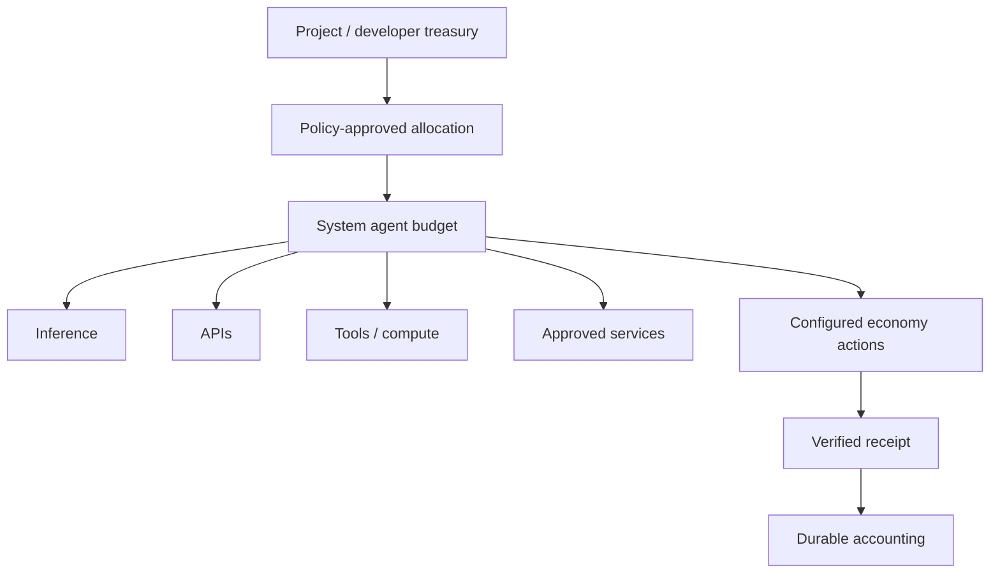
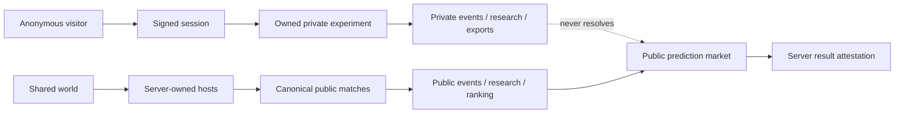

# Public product model

The public application has one shared world and many logically isolated private experiments. They reuse simulation and presentation components, but they do not share ownership, statistics, research, or economic authority.

## Shared main world

The shared world is a canonical, continuously hosted public run:

- `/world` provides common presence, NPC profiles, the Arena entrance, and a free Tic-Tac-Toe table.
- `/arena` exposes the continuous Rust-authoritative Survival match and the hosted RPS/Tic-Tac-Toe rooms.
- public agent profiles, retained results, cumulative statistics, and Research House summaries derive from server-owned canonical matches.
- spectators can inspect and download public evidence but cannot advance a match or select its winner.
- presence and animation frames are transient; authoritative results and research are durable.

The first deployment uses one long-running service and one canonical world namespace. A refresh or new anonymous visitor does not create another shared world.

## Production data boundaries

Committed source data contains canonical agent definitions, strategies, rules, maps, sprites, schemas, documentation, and explicitly labeled fixtures. Runtime state is never source data. A production `MATCHES_DIR` is a separate persistent volume: startup accepts it only when it is empty or carries the idempotent `.production-bootstrap.json` marker. An unmarked nonempty directory is rejected, which prevents a developer's local `matches/` directory from becoming public history.

On a fresh volume, the bootstrap records the `main` world and twenty canonical agent IDs, then the normal schedulers create new Arena checkpoints. It creates no completed matches, visitor sessions, private experiments, balances, receipts, or research records. The first anonymous browser therefore starts with empty private lists, while public history begins accumulating only from matches generated by that deployment.

## Private user experiments

A private experiment belongs to the random anonymous session stored in one browser's signed, HTTP-only cookie. The server creates the experiment ID and records its owner session, seed, configuration, status, timestamps, replay/checkpoint, structured events, research, and retained results.

Every list, load, step, delete, match export, and experiment export checks the owner session. IDs are random and do not confer access. Another browser receives a different session and cannot access the first browser's private data. The browser can resume its experiments while its signed session cookie remains available.

Private runs are personal research and simulation. They do not contribute to:

- canonical public statistics or agent ranking;
- public Research House memory;
- canonical public match IDs;
- public prediction markets;
- system-agent treasury or service-market receipts.

## Private multi-mode arenas

The same signed browser session can also start a private RPS, Tic-Tac-Toe, and
Survival arena at `/private-arena`. These schedulers are logically isolated
from the canonical public rooms, retain their own bounded history, and export
only that owner's records. See [private multi-mode arenas](private-arena.md).

## Agent types

| Type | Ownership and purpose | Current state |
| --- | --- | --- |
| System agent | Stable project-operated identity in the canonical world | Profiles, matches, research, statistics and simulated game behavior work |
| User-owned agent | Future agent bound to an authenticated owner and separately funded budget | Main does not yet expose production ownership/funding APIs |
| External agent | Declarative imported identity using approved provider/MCP capabilities | Local MCP arena works; world registration remains a manual/future boundary |

An owner wallet and an agent budget are separate. Ownership proves who can manage an agent. A budget is a limited allocation that can pay only approved destinations under reserve, exposure, loss, and rate policies.

## System-agent budgets

The initial operating model can use confirmed project/developer funds to allocate system-agent budgets. This is an operator decision, not assumed treasury revenue:

Agents never receive the treasury's unrestricted wallet credentials. Model output proposes an intent; policy authorizes it; a separate signer/payment capability executes it; verification records the result.

## Authority map

The dashed path is forbidden. Private experiments and browser-selected outcomes cannot resolve a public prediction or authorize a public settlement.
