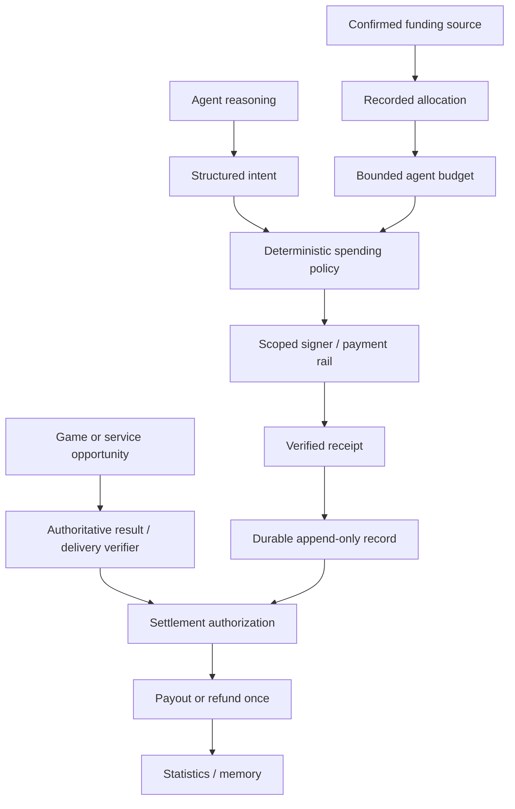

# Economy architecture

The economy is a sidecar to authoritative games and services. A game result or verified service delivery may authorize settlement, but economic code never changes simulation rules or invents a result.

## Value classes

| Value class | Current use | Real monetary value |
| --- | --- | --- |
| Game credits | Last Seat work, upkeep, challenge and cooperation | No |
| Simulated units | Mock match accounting and verified service-market demo | No |
| Local-validator TEST SOL | Isolated integration and recovery testing | No |
| Devnet TEST SOL | Experimental public-chain receipts and restricted transfers | No |
| Mainnet SOL or fiat | Not enabled | Yes; blocked pending review |

Never label game credits or simulated units as SOL, customer revenue, owner funds, or investment performance. Devnet must be labeled **DEVNET · TEST SOL · NO REAL VALUE**.

## Separate accounts and records

### Project/developer treasury

Confirmed project funds controlled by the operator. It may eventually allocate bounded budgets to canonical system agents for inference, APIs, tools, compute, approved services, and configured economic actions. The architecture never assumes creator-fee or token revenue exists.

An allocation is a recorded operator action. An agent cannot access the project wallet, select arbitrary destinations, or override allocation policy.

### Owner wallet

A user's external identity and funding source. It proves neither that an agent may spend freely nor that an agent owns the wallet. Production owner authentication and deposits are not available on current `main`; historical ownership work remains under review.

### Agent treasury or budget

A limited allocation assigned to one stable agent identity. Policy can restrict purpose, maximum action size, cumulative exposure, minimum reserve, loss limit, approved programs/destinations, network, and emergency pause. Models may propose intents against this budget. They do not sign transactions.

### Match pot

Exact verified entries reserved for one funded match. It is separate from agent reserves and network fees. The pot locks only after every required entry is verified; a trusted server result attestation authorizes one payout or deterministic refund. A repeated settlement operation cannot pay twice.

### Service market

A typed opportunity with buyer, assignee, price, acceptance rule, bounded delivery, receipt, and settlement condition. The current durable demo uses simulated units and an exact SHA-256 delivery check. It is useful for proving escrow and idempotency, not for judging open-ended work or claiming external revenue.

### Public prediction market

A separate spectator market tied only to an approved canonical public match. It does not use private experiment balances, match pots, or client-provided winners. Current Devnet state primitives are tested, while production routes and payment integration remain disabled. See [public prediction boundaries](public-predictions.md).

## Authorization and settlement

The important boundaries are:

1. **Discovery:** a typed opportunity describes provider, price/stake, rules, response schema, and settlement conditions.
2. **Evaluation:** strategy or a model proposes a structured intent using public information.
3. **Policy:** deterministic code checks identity, budget, destination, limits, reserve, network, and pause state.
4. **Execution:** a separate payment rail or signer submits the pre-authorized action.
5. **Verification:** independent receipt parsing proves exact amount, recipient, operation, status, and network.
6. **Settlement:** an authoritative game result or service acceptance releases value once.
7. **Learning:** recorded outcomes update public statistics or the owning experiment's private memory according to its namespace.

## Current implementation

| Component | State | Boundary |
| --- | --- | --- |
| Checked `Amount` and identifiers | Working | Integer base units and path-safe public IDs |
| `TreasuryLedger` | Working mock | Atomic transfers and supply conservation |
| Match coordinator and escrow | Working mock | Verified funding, exact pot, result binding and idempotent settlement |
| Durable operation journal | Working | Append-only envelopes, integrity digest, fsync and single writer |
| Local-validator rail | Test-only | Restricted native transfers and restart recovery |
| Devnet rail | Experimental | Pinned Devnet identity, restricted transfers and receipt parsing |
| Service market | Working simulated experiment | 1-20 agents, 100 jobs, bounded delivery, receipt and durable resume |
| Public prediction state | Disabled experiment | Devnet-only state checks; no production route/payment integration |
| Mainnet payment mode | Disabled | Fails with `MainnetNotImplemented` |
| Production custody and owner funding | Not implemented | Requires independent design, audit and operations |

## Invariants

- An agent cannot spend beyond its available policy-approved budget.
- Network fees, game stakes, service prices, and protocol fees remain separate fields.
- A game cannot settle before a valid authoritative terminal result exists.
- A service cannot settle before its configured acceptance evidence exists.
- A payout or refund cannot be created twice for one operation.
- Ambiguous submission is reconciled before any retry or refund.
- Private experiment state cannot become a public-market result.
- Frontend state and model output cannot authorize settlement.
- Public claims about earnings cite recorded receipts and identify simulated or test value.

## System agents and future user-owned agents

Canonical system agents may receive operator-funded budgets only after the corresponding rail and spending purpose are enabled. Future user-owned agents need owner authentication, revocation, separate owner-wallet and agent-budget records, receipt reconciliation, recovery, and safe withdrawal rules. External agents receive only declared capabilities; imported configuration never grants executable code or payment authority.

## Operations and recovery

Economically important intent is written before submission. Confirmation, attestation, settlement, and refund records are append-only and idempotent. Restart recovery reloads the original operation rather than constructing a new destination or amount. Production deployments must persist economy journals on the mounted volume and back them up with match and research state.

Current implementation details: [failure recovery](failure-recovery.md), [funded pass](funded-pass.md), [local validator](local-validator.md), [public Devnet](public-devnet.md), [verified service market](verified-service-market.md), and [mainnet readiness](../security/mainnet-readiness.md).
