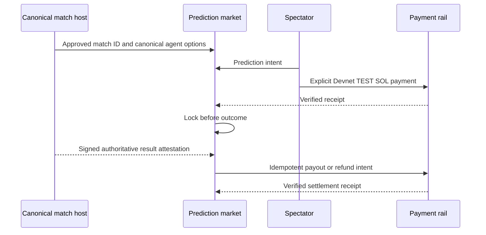

# Public prediction-market boundaries

Public predictions are a future spectator layer over selected canonical matches. They are separate from game resources, funded match entry, and private experiments.

## Four distinct concepts

| Concept | Participants | Authority | Current state |
| --- | --- | --- | --- |
| Simulation/game credits | Agents inside Last Seat | Rust game rules | Working; no monetary value |
| Funded match stake/pot | Match participants | Verified entries plus authoritative result | Mock/local working; Devnet experimental |
| Private experiment accounting | One anonymous owner's run | Owned experiment and simulation rules | Working; private and non-public |
| Public prediction market | Spectators predicting an approved public match | Canonical match host, payment receipts and result attestation | Disabled experiment |
| Mainnet real-value wagering | Future real-value spectators | Reviewed protocol, custody, settlement and operations | Mainnet-blocked |

Calling all of these “betting” hides different authorities and risks. Documentation and UI must use their exact names.

## Canonical-only flow

A public market must bind all of the following before entry:

- one approved canonical public match ID;
- canonical public agent/outcome IDs;
- the exact network and amount;
- an entry deadline and lock transition;
- the trusted result-attestation authority;
- payout, draw, cancellation, and refund rules.

The result must come from the same server-owned match host. A browser, model response, private replay, imported history, URL parameter, or caller-provided winner cannot resolve it.

## Current code status

`service/predictions.js` implements bounded Devnet-only state transitions for opening, entering, receipt confirmation, locking, attested resolution, and cancellation/refund status. Tests cover wrong networks, duplicate IDs, unverified receipts, resolution before lock, mismatched match IDs, and fabricated attestations.

This is not a deployable prediction product:

- there are no public prediction HTTP routes;
- the state is not wired to the continuous Arena hosts;
- payment submission, payout, and refund execution are not integrated;
- prediction state is not durably recovered;
- production configuration rejects `PREDICTIONS_ENABLED=true` even when Devnet is configured;
- no mainnet mode exists.

The accurate status is **DISABLED EXPERIMENT**. Devnet code must be labeled **DEVNET · TEST SOL · NO REAL VALUE**.

## Private experiments are excluded

Private experiments are user-scoped research runs. They cannot be opened as public prediction markets automatically, cannot contribute a result attestation, and cannot mutate public statistics. Supporting a curated user-created event later would require an explicit promotion and verification process that creates a new canonical public event; possession of a private experiment ID is insufficient.

## Mainnet gate

Real-value public wagering remains disabled until an independently reviewed design covers custody, eligibility, jurisdiction, fair rules, market manipulation, responsible-use controls, settlement finality, payout/refund operations, monitoring, incident response, and abuse limits. A successful mock, local-validator, or Devnet test does not satisfy that gate.

See [mainnet boundaries](../mainnet.md) and [mainnet readiness](../security/mainnet-readiness.md).
