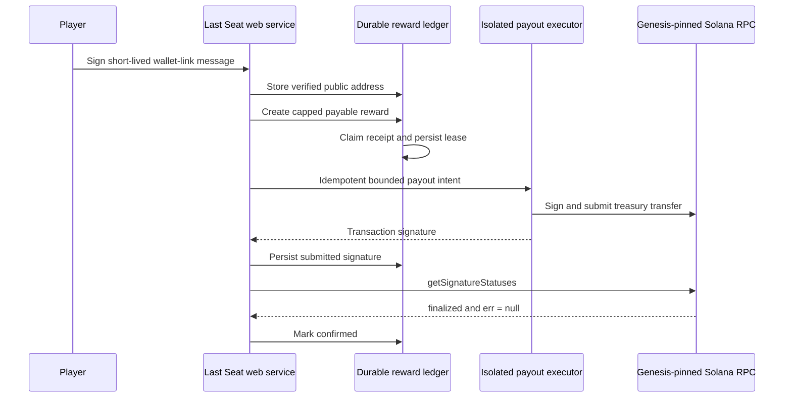

# Solana player payout operations

This runbook describes the optional reward rail for world gathering. It does not add paid entry, wagering, agent custody, or automatic access to player wallets.

## Trust boundaries



The signer is a separate service or custody provider. It must never expose a seed phrase or raw private key to this repository, the browser, an agent, a prompt, or the public web process. Its `/v1/payouts` endpoint must authenticate the caller, require `Idempotency-Key`, return the original signature for a repeated intent, pin the treasury and genesis hash, and reject amounts above its own caps.

## Required configuration

Real payout startup fails unless every control is present:

```text
WORLD_SOL_PAYOUTS_ENABLED=1
WORLD_TREASURY_ADDRESS=<public address>
WORLD_SOL_PAYOUT_CLUSTER=mainnet-beta
WORLD_SOL_PAYOUT_ACK=I_UNDERSTAND_REAL_SOL
WORLD_SOLANA_GENESIS_HASH=<expected genesis hash>
WORLD_SOLANA_RPC_URL=https://<dedicated RPC>
WORLD_PAYOUT_EXECUTOR_URL=https://<isolated signer>/v1/payouts
WORLD_PAYOUT_EXECUTOR_TOKEN=<secret of at least 32 characters>
WORLD_LAMPORTS_PER_CREDIT=<positive integer>
WORLD_MAX_PAYOUT_LAMPORTS=<per-receipt cap>
WORLD_DAILY_PAYOUT_CAP_LAMPORTS=<daily cap>
WORLD_MAX_PAYOUT_ATTEMPTS=5
```

Production also requires stable `HOST_SESSION_SECRET`, canonical HTTPS `PUBLIC_ORIGIN`, and an absolute durable `MATCHES_DIR`. `DEPLOYMENT_MODE=EPHEMERAL_DEMO` is rejected when payouts are enabled. Use a managed database or persistent volume with backups before moving any real value.

For Devnet, use `WORLD_SOL_PAYOUT_CLUSTER=devnet` and `WORLD_SOL_PAYOUT_ACK=I_UNDERSTAND_TEST_SOL_ONLY`. Devnet validation must precede mainnet operation.

## Executor response contract

The web service sends version 1 JSON containing `intent_id`, `idempotency_key`, `recipient`, `treasury`, `amount_lamports`, `cluster`, `genesis_hash`, and a `lastseat:<reward-id>` memo. A successful executor returns:

```json
{
  "intent_id": "<same reward ID>",
  "transaction_signature": "<base58 Solana signature>"
}
```

HTTP acceptance is not settlement. Solana `sendTransaction` only reports RPC acceptance, so the web worker separately calls `getSignatureStatuses` and requires `err: null` with `confirmationStatus: finalized` before it marks the reward confirmed.

## Rollout checklist

1. Replace the free ephemeral demo with durable storage and tested restore/backups.
2. Deploy the signer in a separate security boundary and configure its treasury allowlist, cluster genesis pin, per-transfer cap, daily cap and reserve floor.
3. Fund a dedicated low-balance Devnet treasury; test duplicate requests, timeout-after-broadcast, failed transaction, RPC mismatch and restart recovery.
4. Verify the wallet-signature UX on at least two wallet providers without requesting secret material.
5. Reconcile ledger totals against chain transactions and alert on `held`, `failed`, stale `submitting`, or long-lived `submitted` receipts.
6. Obtain security review and legal/accounting guidance before mainnet rewards.
7. Fund a dedicated limited mainnet treasury only after all controls pass; enable the feature flag last.

Emergency stop is `WORLD_SOL_PAYOUTS_ENABLED=0` followed by a service restart. Disabling the worker does not erase submitted receipts; reconcile every recorded signature before retrying or paying manually.
